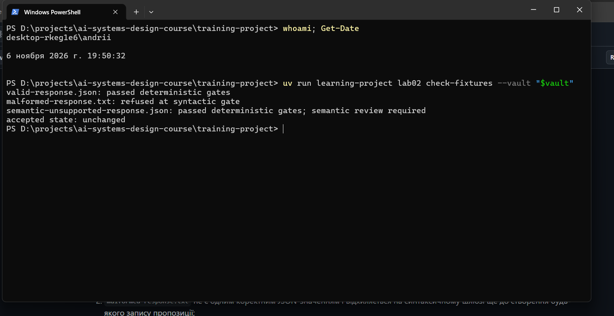
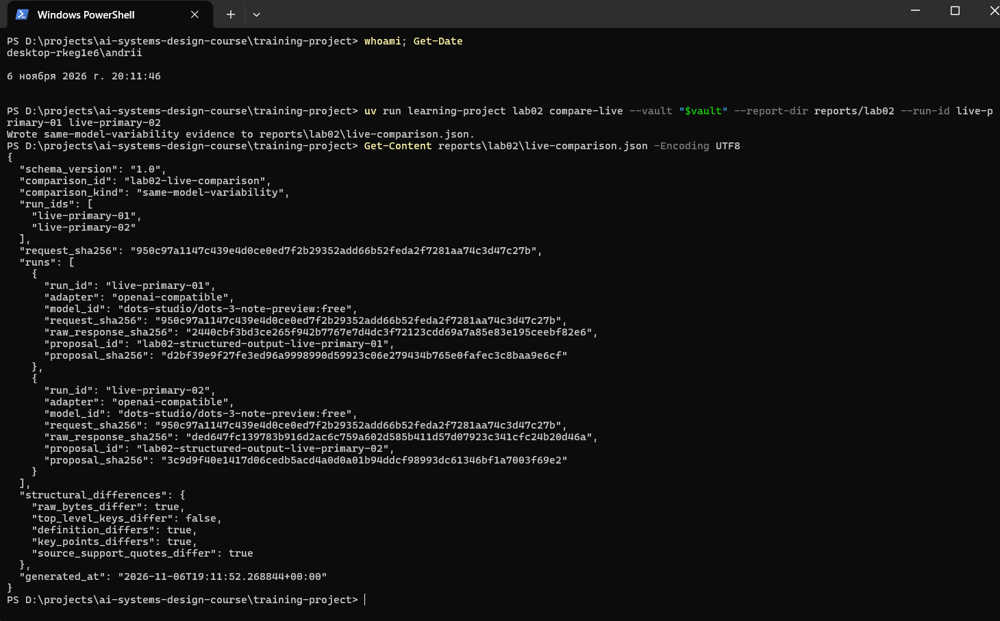
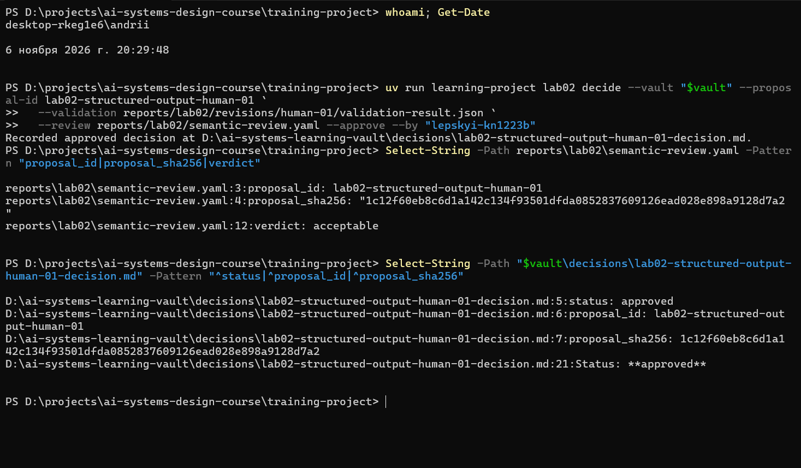
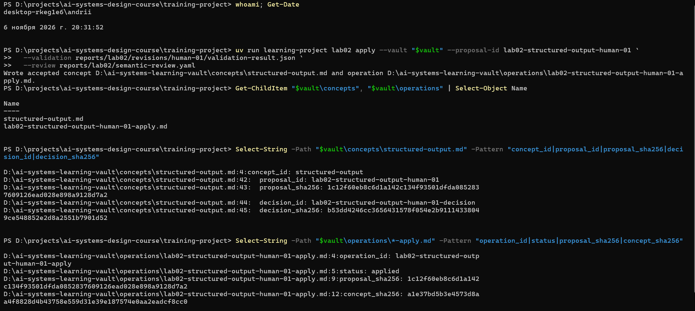
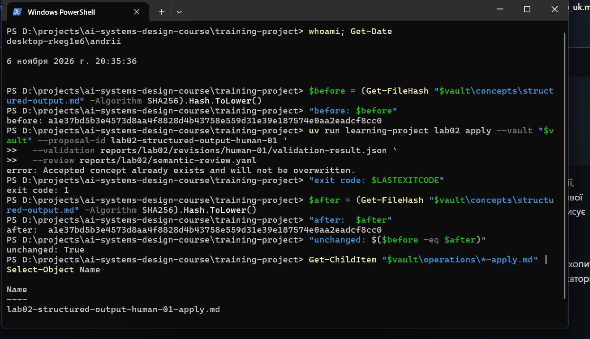
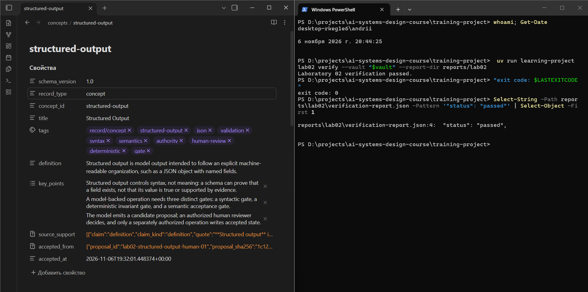

# Лабораторна робота 02

## Ідентифікація подання

- URL форку: https://github.com/Andreww-uni/ai-systems-design-course
- Назва особистої гілки: lab02/lepskyi-kn1223b
- Повний хеш коміту зі свідченнями:

## Мета роботи

Метою роботи є встановлення та демонстрація меж повноважень у єдиному керованому процесі розгляду концептуальної пропозиції, створеної моделлю. Детерміноване програмне забезпечення перевіряє відповідність кандидата встановленим вимогам, уповноважена людина оцінює його зміст і ухвалює рішення, а канонічний стан змінюється лише після одноразового застосування затвердженого кандидата. Очікуваним станом системи є нейтральне щодо постачальника канонічне поняття `Structured Output`, яке походить від живої відповіді моделі та зв’язане дайджестами SHA-256 на етапах перевірки, розгляду, рішення й застосування.

## Початковий стан і реєстрація джерела

Робота виконувалася на робочій станції Windows 11 25H2 (build 26200) у Windows PowerShell 5.1 з uv 0.12.19 і Git 2.53.0. Клон форку розташований у `D:\projects\ai-systems-design-course`, а зовнішнє сховище Markdown-файлів — у `D:\ai-systems-learning-vault`, поза клоном. На початку роботи сховище містило `README.md` і `sources/module-01-ai-engineering-foundations.md` з Лабораторної роботи 01; теки `concepts/` ще не існувало.

Гілку `main` синхронізовано з `upstream/main` командами `git fetch upstream`, `git merge upstream/main` (fast-forward) і `git push origin main`, після чого `main`, `upstream/main` та `origin/main` вказували на коміт `df62b5f2419d85115d3ead9ecfdf7f0db9b9cca7`. Із синхронізованої `main` створено особисту гілку `lab02/lepskyi-kn1223b`. Пропозиція, рішення та прийнята межа Лабораторної роботи 01 залишилися незмінними.

Перед виконанням операцій запущено публічні тести (254 тести): `FAILED (failures=2, errors=22, skipped=3)`. Аналіз повного виводу показав, що 22 помилки стосуються тестів лабораторних робіт 04 і 05 і спричинені `WinError 1314` (Windows не дозволяє створювати символічні посилання без режиму розробника), одна невдача пов’язана з відсутнім необов’язковим пакетом `lab04`, а єдина невдача Лабораторної роботи 02 (`test_verify_passes_before_and_after_a_student_only_commit_in_a_real_git_repo`) повідомляла `Raw digest changed`. Цей тест створює тимчасовий Git-репозиторій, який успадковує глобальне налаштування `core.autocrlf=true`, тому під час вивантаження змінюються закінчення рядків і дайджест сирої відповіді. Повторний запуск `tests.public.test_lab02_verify` з `core.autocrlf=false`, встановленим лише для процесу через змінні `GIT_CONFIG_*`, завершився `OK` для всіх 13 тестів. У робочому клоні `core.autocrlf=false` встановлено локально ще з Лабораторної роботи 01, тому свідчення лабораторної роботи цієї проблеми не мають. Код курсу не змінювався.

Командою `lab02 register-source` зареєстровано джерело `module-02-foundation-models-and-ai-application-architecture` з фрагментом `module-02-1-3-structured-output-controls-v1` (повний підрозділ `### 1.3 Structured output controls syntax, not meaning` англомовної теорії). Запис джерела фіксує `course_commit: df62b5f2419d85115d3ead9ecfdf7f0db9b9cca7`, `source_file_sha256: e89d5201…b372` і `fragment_sha256: 7d7d5ce2…7063`. Дайджест файлу теорії збігся з дайджестом того самого файлу в репозиторії викладача, що підтвердило відсутність перетворення закінчень рядків.

`course_commit` є незмінним базовим станом джерела, а не комітом подання: він фіксує точну версію матеріалів курсу, з якої взято фрагмент. Остаточний перевіряльник вимагає, щоб цей коміт був предком `HEAD`, і порівнює з ним шляхи, що належать upstream; коміти студента під `training-project/reports/` створюються пізніше і не змінюють базового стану. Тому повторна реєстрація після коміту звіту не виконувалася.

## Детерміновані шлюзи

Після копіювання шаблону звіту запущено `lab02 check-fixtures`, який опрацьовує три затверджені фікстури в тимчасовому стані без звернення до моделі та без зміни сховища:

- `valid-response.json`: `passed deterministic gates` — фікстура є одним коректним JSON-об’єктом і задовольняє обов’язкові поля, ідентифікатори, допустимі значення та вимогу точних цитат;
- `malformed-response.txt`: `refused at syntactic gate` — вміст не розбирається як одне JSON-значення, тому запис пропозиції не створюється;
- `semantic-unsupported-response.json`: `passed deterministic gates; semantic review required` — структура коректна, але визначення та цитати потребують оцінювання уповноваженим рецензентом;
- підсумок `accepted state: unchanged` підтверджує, що прийнятий стан не змінився.

Синтаксичний шлюз встановлює лише можливість розбору, а шлюз інваріантів — лише наявність і форму полів та збіг цитат із джерелом. Жоден із цих шлюзів не оцінює, чи правильно кандидат інтерпретує джерело, тому їхнє успішне проходження не є семантичним схваленням. Третя фікстура демонструє саме такий випадок.

Рисунок — `01-offline-gates.png`

## Живі запуски та порівняння

Для обох запусків командою `lab02 prepare` створено запит `model-request.json` (`request_id: lab02-structured-output-v1`). Обидва файли запиту побітово тотожні; їхній спільний дайджест `request_sha256` дорівнює `950c97a1…c27b`. Antigravity CLI на робочій станції недоступний, тому використано перевірений безоплатний запасний шлях OpenRouter (`run-openrouter`, маршрутизатор `openrouter/free`). Ключ передавався лише через змінну середовища процесу.

- `live-primary-01`: адаптер `openai-compatible`, модель `dots-studio/dots-3-note-preview:free`. Синтаксичний шлюз пройдено, шлюз інваріантів — ні: `source_support entry 1 quote is not exact source text`. Модель відтворила речення визначення без Markdown-розмітки `**Structured output**`, присутньої в джерелі, тому цитата перестала бути точним підрядком фрагмента. Відповідно до процедури пропозицію та сиру відповідь не редагували.
- `live-primary-02`: перша спроба завершилася повідомленням `OpenRouter response did not finish normally`; каталог запуску після неї містив лише `model-request.json`, тобто часткових свідчень не залишилося. Повторна спроба під тим самим ідентифікатором записала відповідь тієї самої моделі (`openai-compatible`, `dots-studio/dots-3-note-preview:free`), яка пройшла обидва детерміновані шлюзи (`valid: true`).

Команда `lab02 compare-live` записала `live-comparison.json` з `comparison_kind: same-model-variability`. Класифікація випливає із записаних метаданих: в обох `run-metadata.json` збігаються адаптер і `model_id`, а дайджест запиту спільний. Структурні відмінності: `definition_differs`, `key_points_differs`, `source_support_quotes_differ` мають значення `true`, `top_level_keys_differ` — `false`. Конкретна відмінність: у запуску 01 визначення містить два речення джерела, а ключові пункти описують три шлюзи, тоді як у запуску 02 визначення містить лише перше речення, а ключові пункти є фрагментами переліку методів форматування. Спостережена відмінність за того самого адаптера та моделі не доводить, що єдиною причиною є вибірка: маршрутизатор постачальника, стан служби та інші параметри обслуговування не контролювалися.

Рисунок — `03-live-comparison.png`

## Семантична коректність і повноваження

Успішний `validate` доводить лише, що кандидат синтаксично розбирається, містить обов’язкові поля з допустимими значеннями і що кожна цитата є точним підрядком зареєстрованого фрагмента. Схема на стороні постачальника може гарантувати форму JSON, але не гарантує істинності значень. Запуск `live-primary-02` це підтвердив: усі його цитати точні та релевантні, проте ключові пункти не передають центральної ідеї поняття.

Повноваження прийняти або відхилити кандидата має лише уповноважений рецензент — у цій роботі студент `lepskyi-kn1223b`. Модель лише пропонує кандидата і не може ні затвердити, ні застосувати його. Детермінований код перевіряє структуру, прив’язує рішення до дайджестів і відмовляє у застосуванні без затвердження, але не має семантичних повноважень. Операція `apply` є окремою і записує прийнятий стан лише з відповідного затвердженого рішення.

## Семантичний розгляд і рішення

Кандидат `live-primary-01` не розглядався семантично, оскільки не пройшов шлюз інваріантів.

Кандидата `lab02-structured-output-live-primary-02` розглянуто за шістьма запитаннями. Визначення коректно відтворює перше речення джерела; три цитати точні й підтримують відповідні `claim_kind`; непідтвердженого значення не додано; теги не містять метаданих постачальника. Проте ключові пункти є фрагментами переліку методів форматування, третій пункт об’єднує чотири методи без розділових знаків, і жоден пункт не розрізняє три шлюзи контролю та не фіксує межі повноважень. Вердикт — `unsupported`. Розгляд збережено в `reports/lab02/reviews/lab02-structured-output-live-primary-02.yaml`, а рішення `rejected` записано командою `decide --reject`.

Під час підготовки цього розгляду обчислений дайджест пропозицій не збігся з дайджестами, записаними під час перевірки та порівняння. З’ясовано, що відкриття файлів пропозицій в Obsidian для читання призвело до їх пересохранення із заміною закінчень рядків CRLF на LF. Текст не змінився, але змінилися байти. Повернення CRLF відновило точні початкові дайджести (`d2bf39e9…` і `3c9d9f40…`), що перевірено повторним обчисленням; після цього Obsidian не використовувався до остаточної перевірки. Цей випадок демонструє, що прив’язка SHA-256 виявляє зміну, непомітну під час візуального перегляду.

Для виправлення обрано шлях людської ревізії замість ще одного генерування, бо визначення та цитати запуску 02 є прийнятними, а недолік стосується лише ключових пунктів. Файл `reports/lab02/revisions/human-01.yaml` посилається на батьківську пропозицію `live-primary-02` та її дайджест і замінює тільки `key_points` трьома пунктами, що переказують зміст фрагмента §1.3: структурований вихід контролює синтаксис, а не значення; операція з використанням моделі потребує трьох шлюзів; модель пропонує, рецензент вирішує, а прийнятий стан записує лише окремо уповноважена операція. Команда `revise` створила нового кандидата `lab02-structured-output-human-01`, який пройшов `validate`.

Повторний розгляд кандидата `human-01` дав позитивні відповіді на всі шість запитань, вердикт — `acceptable`. Розгляд записано в `reports/lab02/semantic-review.yaml` з `proposal_sha256: 1c12f60e…d7a2` і `validation_sha256: 6a5745be…c1ea`. Команда `decide --approve` записала рішення `approved`. Рішення стосується саме цього кандидата, бо воно прив’язує точні дайджести файлу пропозиції, результату його перевірки та розгляду; будь-яка зміна цих байтів зробила б рішення непридатним для застосування.

Рисунок — `04-review-decision.png`

## Прив’язки SHA-256

- Джерело і фрагмент: запис джерела фіксує дайджест файлу теорії (`e89d5201…`) і фрагмента §1.3 (`fragment_sha256: 7d7d5ce2…`) на `course_commit`; пропозиції повторюють `source_sha256` (`9f4e0566…`) і `fragment_sha256`.
- Запит і відповідь: `run-metadata.json` кожного запуску зв’язує `request_sha256` (`950c97a1…`, спільний для обох запусків) із `raw_response_sha256` (`2440cbf3…` для запуску 01, `ded647fc…` для запуску 02).
- Відповідь і пропозиція: розділ `evidence` пропозиції містить дайджести запиту та сирої відповіді; ревізія `human-01` додатково фіксує `derived_from.proposal_sha256: 3c9d9f40…` і `revision_input_sha256`.
- Пропозиція і перевірка: `validation-result.json` містить `proposal_sha256: 1c12f60e…`.
- Розгляд і рішення: розгляд фіксує дайджести пропозиції та перевірки, а рішення — дайджести пропозиції, перевірки (`6a5745be…`) і розгляду (`semantic_review_sha256: 3d2dd266…`).
- Рішення і прийняте поняття: операція застосування фіксує `proposal_sha256`, `decision_sha256: b53dd424…` і `concept_sha256: a1e37bd5…`; поняття містить `accepted_from` з дайджестами пропозиції та рішення.

Ці дайджести ідентифікують точні байти й виявляють пізнішу зміну. Вони не доводять, що відповідь справді згенерувала названа зовнішня модель (`attribution_limit` у метаданих прямо це зазначає), не доводять семантичної правильності кандидата і не автентифікують особу, вказану в `recorded_by`, `reviewed_by` чи `--by`.

## Контрольоване застосування

Команда `lab02 apply` для `lab02-structured-output-human-01` створила канонічне поняття `concepts/structured-output.md` і єдиний запис операції `operations/lab02-structured-output-human-01-apply.md` зі `status: applied`. Застосування дозволили: результат перевірки `valid: true`, розгляд із вердиктом `acceptable`, рішення `approved`, що прив’язує точні дайджести пропозиції, перевірки та розгляду, походження кандидата від живого запуску `live-primary-02` і незмінне зареєстроване джерело. Дайджест створеного поняття `a1e37bd5…` збігається з `concept_sha256` у записі операції.

Рисунок — `05-controlled-apply.png`

## Відмова без зміни прийнятого стану

Повторний запуск тієї самої команди `apply` завершився повідомленням `error: Accepted concept already exists and will not be overwritten` зі статусом виходу `1`. Дайджест `concepts/structured-output.md` до та після спроби однаковий (`a1e37bd5b3e4573d8aa4f8828d4b43758e559d31e39e187574e0aa2eadcf8cc0`), а тека `operations/` і далі містить рівно один запис `lab02-structured-output-human-01-apply.md`.

Рисунок — `02-refusal-unchanged.png`

## Проєктний компроміс

Безоплатний маршрутизатор OpenRouter знижує вартість моделі до нуля і підтримує портативність, але збільшує мінливість: з двох побітово тотожних запитів до тієї самої моделі один кандидат не пройшов шлюз інваріантів, а другий пройшов детерміновані шлюзи, проте мав змістовно слабкі ключові пункти; ще одна спроба взагалі не завершилася нормально. Компенсацією є вартість детермінованих шлюзів і людського контролю: розгляд, відхилення та ревізія потребували часу рецензента. Цей компроміс прийнято, бо без людського розгляду структурно коректний, але змістовно неповний кандидат потрапив би до канонічного стану. Платна модель могла б зменшити кількість відхилень, але не скасувала б потреби в семантичному розгляді.

## Захист облікових і платіжних даних

Ключ OpenRouter створено в обліковому записі постачальника, введено через `Read-Host -AsSecureString` і передано лише через змінну середовища `OPENROUTER_API_KEY` поточного сеансу PowerShell. Ключ не з’являвся в аргументах команд, у `run-metadata.json`, у звіті чи в Git; пошук за префіксом ключа у файлах обох запусків не дав збігів. На знімки екрана сторінка ключа не потрапляла. Під час реєстрації OpenRouter запропонував перевірку платіжної картки, але її було відкладено; дані картки не вводилися і не потрапили до жодного артефакту.

## Канонічний, аудиторський і похідний стан

Канонічним прийнятим знанням є `concepts/structured-output.md` у зовнішньому сховищі.

Незмінними свідченнями аудиту та запусків є: запис джерела в `sources/`; пропозиції `proposals/lab02-structured-output-live-primary-01.md`, `…-live-primary-02.md` і `…-human-01.md`; рішення в `decisions/` (`rejected` для запуску 02 і `approved` для `human-01`); запис операції в `operations/`; у репозиторії — `reports/lab02/runs/<run-id>/` (`model-request.json`, `raw-response.txt`, `run-metadata.json`, `validation-result.json`), `live-comparison.json`, `reviews/`, `revisions/` і `semantic-review.yaml`.

Похідними результатами, які можна відбудувати, є `verification-report.json` (повторним запуском перевіряльника) і `reports/lab02/submission/REPORT.md` (командою `prepare-report`).

## Остаточна перевірка

Команда `lab02 verify` завершилася з результатом `status: passed` і статусом виходу `0`; прийняте поняття відображається в Obsidian поруч із цим результатом. Перевіряльник підтвердив зареєстроване джерело та дайджест фрагмента, предковий зв’язок `course_commit` і незмінність шляхів upstream, три фікстури, два живі запуски зі спільним дайджестом запиту, класифікацію порівняння, походження та перевірку обраного кандидата, прив’язки розгляду й рішення, прийняте поняття та єдину операцію, ізоляцію полів постачальника і шість посилань на знімки екрана.

Остаточна перевірка доводить внутрішню узгодженість ланцюга та дотримання меж повноважень. Вона не доводить криптографічно, що зовнішня модель виконала виведення, і не оцінює семантичної правильності поняття; це судження зафіксоване в семантичному розгляді.

Рисунок — `06-final-result.png`

## Висновки

Зареєстровано точний фрагмент джерела, продемонстровано три шлюзи керування на фікстурах, отримано дві живі відповіді на побітово тотожний запит і класифіковано їх як `same-model-variability`. Перший кандидат зупинено на шлюзі інваріантів, другий відхилено під час семантичного розгляду, а виправлений людиною кандидат `human-01` затверджено й одноразово застосовано. Повторне застосування відхилено без зміни прийнятого стану, а випадкову зміну файлів пропозицій виявлено за дайджестами й усунено відновленням точних байтів. Як допоміжний інструмент для пояснень і перевірки кроків використано Claude; генерування живих кандидатів виконувала лише модель, отримана через адаптер курсу. На підставі наведених свідчень мету роботи досягнуто повністю.
