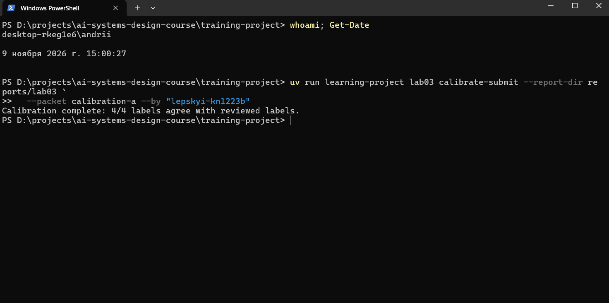
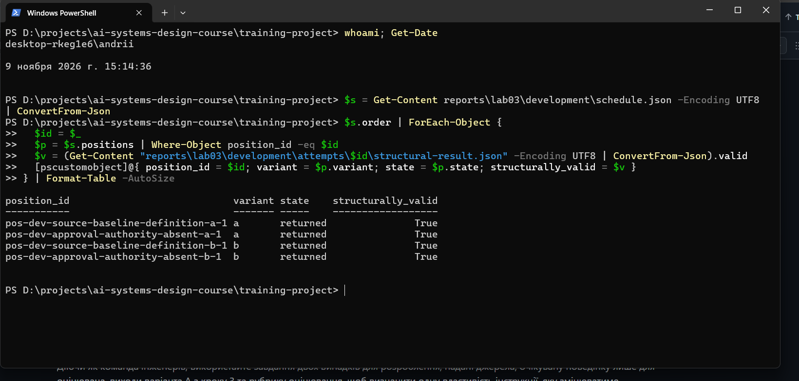
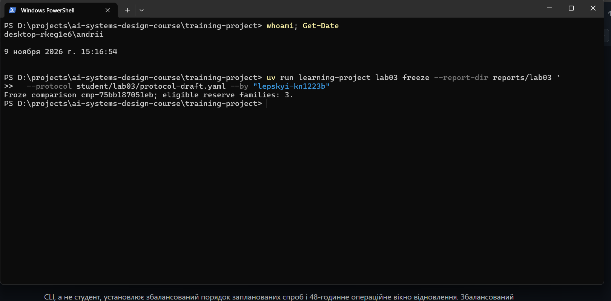
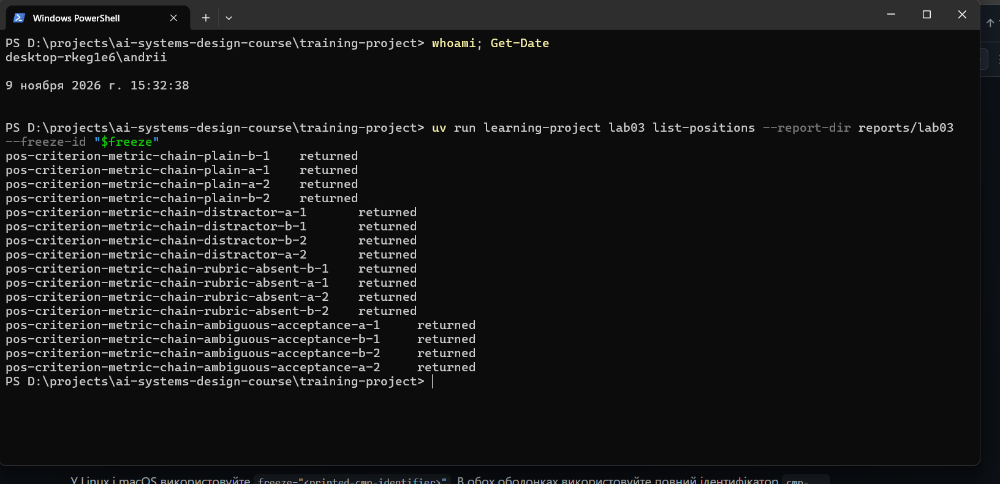
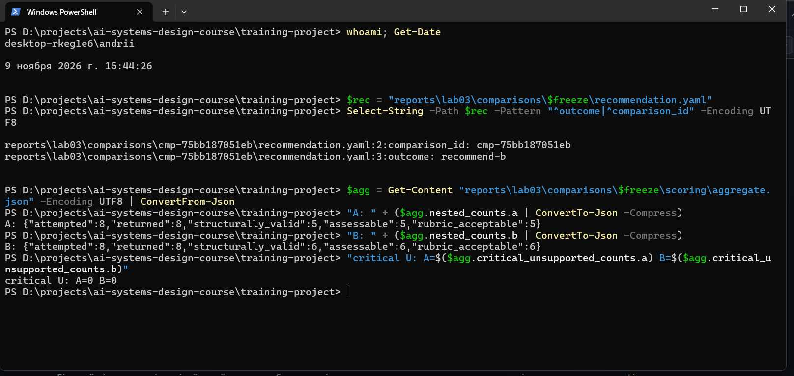
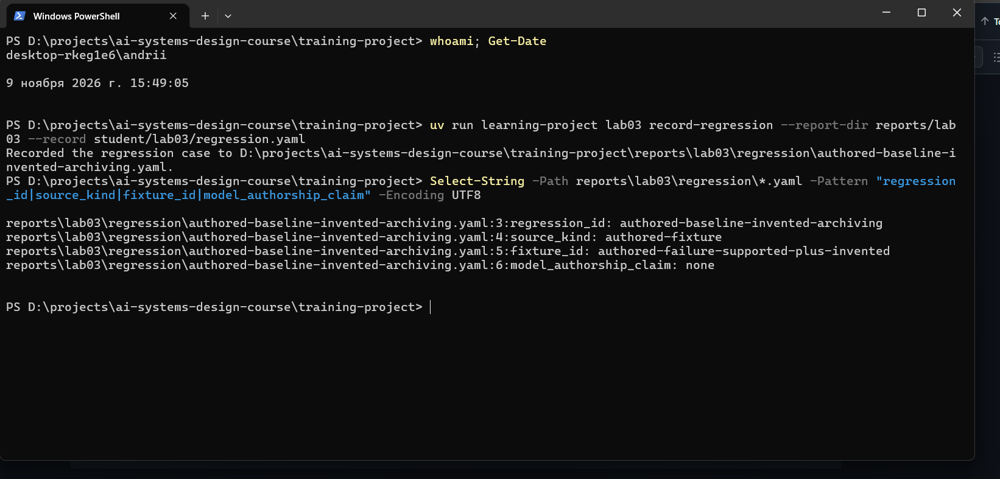

# Лабораторна робота 03

## Ідентифікація подання

- URL форку: https://github.com/Andreww-uni/ai-systems-design-course
- Назва особистої гілки: lab03/lepskyi-kn1223b
- Статус завершення: `complete`

Повний хеш остаточного коміту та результат його перевірки містяться в окремому згенерованому `verification-report.json`. Їх не вписують у цей звіт до коміту, оскільки така зміна створила б інший коміт.

## Мета роботи

Метою роботи є отримання свідчень, достатніх для того, щоб команда інженерів вирішила, чи має кандидатна конфігурація — варіант B — замінити базову конфігурацію експерименту — варіант A — для оцінюваного використання операції пропозиції поняття з використанням моделі. Рішення має спиратися на зафіксований до відкриття відкладених випадків спільний протокол експерименту, сліпе абсолютне оцінювання за рубрикою та п’ять послідовних підрахунків для кожної конфігурації.

## Початковий стан і межа лабораторної роботи 02

Гілку `lab03/lepskyi-kn1223b` створено від завершеної гілки `lab02/lepskyi-kn1223b` (коміт `8e73a72`). Вхідну перевірку виконано на одноразовій копії `reports/lab02` у тимчасовому каталозі: `lab02 verify` повідомив `Laboratory 02 verification passed.`, після чого копію видалено; `git status --short` не показав змін у закомічених свідченнях лабораторної роботи 02. Потім отримано `upstream/main` і злито його в гілку лабораторної роботи 03 (злиттєвий коміт `5fe73c4` поверх `5148567`) без конфліктів, виконано `uv sync`, скопійовано шаблон звіту та створено `student/lab03/`.

Лабораторна робота 03 не створювала й не змінювала файлів у зовнішньому сховищі. Дайджест прийнятого поняття `concepts/structured-output.md` (`a1e37bd5…8cc0`) після розгалуження залишився таким самим, як після лабораторної роботи 02, тож прийняте поняття `Structured Output` та його аудиторський ланцюг не змінено. Шлях до сховища використано лише для вхідної перевірки лабораторної роботи 02.

## Калібрування оцінювача

Активний пакет калібрування — `calibration-a`. Після команди `calibrate` переглянуто лише `tasks` і `authored_outputs`; розглянуті мітки не відкривалися до подання власних міток. Чотири авторські відповіді оцінено за алгоритмом рубрики §2.3 (перевірка придатності до оцінювання, потім непідкріплених тверджень, потім обґрунтованості невизначеності, потім повноти) з урахуванням очікуваної поведінки двох завдань:

- `cal-a-1` — `S`: зв’язок між базовим станом джерела та матеріалом для розгляду пропозиції збережено без доданих тверджень;
- `cal-a-2` — `I`: непідкріплених тверджень немає, але втрачено роль матеріалу в розгляді пропозиції;
- `cal-a-3` — `U`: твердження про автоматичне затвердження пізніших змін відсутнє в джерелі, а перевірка непідкріплених тверджень передує перевірці повноти;
- `cal-a-4` — `Q`: відповідь прямо називає відсутню в джерелі тривалість зберігання.

Команда `calibrate-submit` заморозила мітки та повідомила `Calibration complete: 4/4 labels agree with reviewed labels.` Розбіжностей немає, тому уточнення правил рубрики не знадобилося. Авторські приклади калібрування готують оцінювача і не є свідченням якості моделі за маршрутом `openrouter/free`.

Рисунок — `01-calibration.png`

## Розробницькі випадки

Курс надає два розробницькі випадки, які дозволено оглядати до створення варіанта B:

- `dev-source-baseline-definition` — завдання «Define what a source baseline identifies.» з джерелом «A source baseline identifies the material against which a proposal is reviewed.»; джерельних свідчень достатньо, очікувана категорія — `S`;
- `dev-approval-authority-absent` — завдання «State who is permitted to approve a proposal.» з джерелом «The review record stores the reviewer's identity and decision.»; джерело не називає суб’єкта з повноваженнями затверджувати зміни, тому впевнене твердження про такого суб’єкта не підкріплене, очікувана категорія — `Q`.

Обидва випадки є авторськими випадками курсу (`cases/lab03/development/`), а не зібраними з реального використання.

## Розробницькі запуски й діагноз варіанта A

Усі чотири заплановані позиції завершилися результатом `returned` і пройшли `dev-structural-check` (`valid: true`): спочатку дві позиції варіанта A, потім дві позиції варіанта B.

Спостереження для варіанта A:

- `pos-dev-source-baseline-definition-a-1` (спостережена модель `nvidia/nemotron-3.5-super-vl:free`) дослівно повторила речення джерела;
- `pos-dev-approval-authority-absent-a-1` (спостережена модель `cohere/north-mini-code:free`) відповіла, що рецензент, особа якого записана в записі розгляду, «is the one permitted to approve a proposal».

Діагноз: друга відповідь виводить повноваження затверджувати з того факту, що запис зберігає особу рецензента; джерело такого повноваження не встановлює. Інструкція варіанта A лише просить відповісти на завдання щодо наданого джерела і не містить правила для інформації, відсутньої в джерелі. Ці розробницькі спостереження використано лише для вибору задуманого фактора; вони не є фінальним відкладеним порівнянням.

Спостереження для варіанта B (після запису варіанта B): на першому випадку відповідь дослівно повторила джерело, на другому — «The supplied source does not specify who is permitted to approve a proposal; it only states that the review record stores the reviewer's identity and decision.» Маршрут `openrouter/free` у розробницьких запусках розв’язав чотири спроби на чотири різні безоплатні моделі.

Рисунок — `02-development.png`

## Єдина зміна у варіанті B

Змінена властивість інструкції — обмеження «лише за наданим джерелом» з явним правилом для інформації, відсутньої в джерелі. У варіанті A цю властивість не задано. У варіанті B після першого речення додано одне речення: «Use only the supplied source; if the source does not state what the task asks for, say explicitly that the source does not specify it instead of inferring an answer.» Порівняння `variant-a.txt` і `variant-b.txt` показує відмінність лише в цьому рядку.

Передбачуваний механізм: явна заборона виводити відповідь поза джерелом має зменшити непідкріплені твердження (`U`) і збільшити обґрунтовану невизначеність (`Q`) на випадках із недостатніми свідченнями; ризиком є непотрібні відмови (`R`) або скорочені неповні відповіді (`I`) на випадках із достатніми свідченнями.

Незмінними залишилися завдання пропозиції поняття, двопольовий контракт виходу (`case_id`, `proposed_text`), побудова контексту, маршрут `openrouter` / `openrouter/free`, синтаксичний аналізатор і перевіряльник. Інших відмінностей не додано, щоб спостережену різницю можна було пов’язати з одним оголошеним фактором; `change-declaration.yaml` містить `declared_factors`, що збігається з `changed_property`. Файли варіанта B записано командою `record-variant-b` до перегляду його виходів і після цього не змінювали.

## Заморожений протокол

Протокол записано в `student/lab03/protocol-draft.yaml` до відкриття відкладених матеріалів і заморожено командою `lab03 freeze` з ідентифікатором `cmp-75bb187051eb` (доступних резервних родин на момент заморожування — 3). Основні положення:

- інженерне рішення: чи має варіант B замінити варіант A як інструкцію для операції пропозиції поняття, обґрунтованої джерелом, на маршруті `openrouter/free`;
- гіпотеза: явне правило «лише джерело» зменшить `U` і збільшить `Q` на випадках із недостатніми свідченнями, не зменшивши покриття змісту (`S`) на випадках із достатніми свідченнями;
- семантичне прийняття: для кожної конфігурації окремо чисельник `rubric_acceptable`, знаменник `attempted` (усі 8 спроб конфігурації, тож невдалі, структурно нечинні та `X`-відповіді рахуються проти неї), поріг — щонайменше 6 із 8;
- блокувальні відмови: будь-яка категорія `U` у будь-якій відкладеній спробі конфігурації порушує блокувальну умову незалежно від інших підрахунків;
- операційне прийняття: затримка від початку спроби до повернутої відповіді не перевищує 120 секунд; невідомі значення затримки, використання та вартості записуються як невідомі й не дорівнюють нулю;
- правило компромісу: B може замінити прийнятний A лише за відсутності блокувальних відмов, досягнення порогу та `rubric_acceptable` не нижчого, ніж у A; переваги за невідомими вимірами не заявляються;
- правило рішення з чотирма результатами `recommend-b`, `retain-a`, `reject-both`, `seek-more-evidence`;
- бюджет — 16 спроб, часова межа — інтервал від початку кожної запланованої спроби до повернутої відповіді, маршрут — `adapter: openrouter`, `model_id: openrouter/free`.

Збалансований порядок запланованих спроб і операційне вікно відновлення тривалістю 48 годин призначає робочий процес курсу, а не студент; вони не є умовами прийняття. Маніфест заморожування прив’язує дайджестами інструкції обох варіантів, оголошення фактора, протокол, маршрут і розробницькі свідчення, тому змінити будь-що з цього під тим самим ідентифікатором неможливо.

Рисунок — `03-freeze.png`

## Вибір відкладеної родини та виконання

Після заморожування команда `select-family` автономно вибрала родину `reserve-criteria-chain` (авторські випадки курсу, раніше не експоновані) і запланувала 16 позицій: чотири випадки (`criterion-metric-chain-plain`, `-distractor`, `-rubric-absent`, `-ambiguous-acceptance`) × дві конфігурації × дві спроби. Позиції виконано одноразово у виведеному збалансованому порядку.

Усі 16 позицій завершилися результатом `returned`; відмов, незапущених позицій, переривань, проб відновлення чи зміни маршруту не було, жоден `--position-id` не використано повторно. Команда `structural-check` визнала 11 відповідей структурно чинними і 5 нечинними (вміст не є одним коректним JSON-значенням): `rubric-absent-a-1`, `rubric-absent-a-2`, `ambiguous-acceptance-a-2` для варіанта A та `ambiguous-acceptance-b-1`, `ambiguous-acceptance-b-2` для варіанта B. Маршрут `openrouter/free` розв’язав 16 спроб на сім різних безоплатних моделей; ідентифікатор маршруту в протоколі залишився незмінним.

Рисунок — `04-held-out-execution.png`

## Сліпе семантичне оцінювання

Команда `build-scoring` сформувала подання з 11 анонімними мітками `blind-001`…`blind-011` для структурно чинних відповідей. Подання не містило ідентичності варіанта, порядку чи належності спроби, тому категорія призначалася без знання, чи належить відповідь варіанту A або B; це обмежило схильність віддавати перевагу власному варіанту. Ідентичності варіантів поєднано з оцінками лише після їх заморожування.

Кожну відповідь порівняно з наданим джерелом випадку та очікуваною поведінкою лише для оцінювача; для кожного оцінювання записано точний уривок джерела (`--source-pointer`) та обґрунтування. Призначено вісім категорій `S` (випадки `plain` і `distractor`: відношення «критерій — метрика — порівняння» збережено, сторонню примітку про резервні копії не перенесено) і три категорії `Q` (два випадки `rubric-absent`, де відповідь прямо повідомляє, що кількість категорій не визначено, та випадок `ambiguous-acceptance`, де відповідь повідомляє про нерозв’язане посилання, не обираючи значення). Категорії `I`, `U`, `R` і `X` не призначалися. Для `blind-001` (ілюстративні приклади властивостей) і `blind-003` (опис метрики як числової) вузьке обмеження рубрики записано в обґрунтуванні: додані формулювання не змінюють відношення, тому не трактуються як суттєві непідкріплені твердження.

## Агрегати, зрізи й операційні свідчення

П’ять послідовних підрахунків (`aggregate.json`):

| Конфігурація | `attempted` | `returned` | `structurally_valid` | `assessable` | `rubric_acceptable` |
|---|---|---|---|---|---|
| A (базова) | 8 | 8 | 5 | 5 | 5 |
| B (кандидатна) | 8 | 8 | 6 | 6 | 6 |

Побічні свідчення, які не є додатковими знаменниками:

- відмови: A — 0, B — 0; незапущені позиції: A — 0, B — 0; критичні `U`: A — 0, B — 0;
- зрізи: `sufficient-evidence` — A 2/2, B 2/2; `distractor` — A 2/2, B 2/2; `missing-fact` — A 0/2 (обидві відповіді структурно нечинні), B 2/2 (`Q`); неоднозначний випадок — A 1/2 (одна `Q`, одна структурно нечинна), B 0/2 (обидві структурно нечинні);
- відмінності повторних спроб: на випадках `plain` і `distractor` тексти першої та другої спроби відрізняються в межах кожної конфігурації, хоча категорії однакові (`S`), що виявляє мінливість генерування;
- затримка на межі `timing_boundary`: усі повернуті спроби завершилися в межах 3,5–23,1 с, тобто нижче межі 120 с;
- спостережені моделі: для A — п’ять, для B — чотири різні безоплатні моделі; структурні відмови зосереджені в одній моделі на зріз (`nvidia/nemotron-3.5-super-vl:free` для A на `missing-fact`, `dots-studio/dots-3-note-preview:free` для B на неоднозначному випадку);
- невідомі значення: `token_usage`, `quota_usage`, `monetary_cost` — `unknown`.

## Обмежене рішення щодо конфігурації

Командою `select-comparison` вибрано порівняння `cmp-75bb187051eb`, а командою `recommend` записано результат `recommend-b`. Простеження від замороженого протоколу: блокувальна умова не порушена ні для A, ні для B (критичних `U` — 0 і 0); поріг семантичного прийняття 6/8 не досягає A (5/8) і досягає B (6/8); усі повернуті спроби в межах 120 с; за правилом компромісу B не має блокувальних відмов, досягає порогу, а його `rubric_acceptable` (6) не нижчий, ніж у A (5). Отже, правило рішення вибирає `recommend-b`.

Записані обмеження: мала спроєктована вибірка (4 випадки × 2 спроби на конфігурацію, різниця в одну відповідь); неконтрольована мінливість моделі на маршруті `openrouter/free` (сім різних моделей), через яку частина різниці може походити від моделі, а не від інструкції; зосередження структурних відмов в одній моделі на зріз; невідомі використання токенів, квоти та вартість; один оцінювач-людина без вимірювання мінливості оцінювачів. Рішення стосується лише вибору конфігурації і не дозволяє розгортання або запис до прийнятого стану знань.

Рисунок — `05-scoring-recommendation.png`

## Регресійний запис

Відкладене порівняння не містить жодного оцінювання `U`; п’ять відмов є структурними і не мають оцінювання за рубрикою, тому повне простеження не підтверджує семантичної відмови, спричиненої конфігурацією. Відповідно до процедури використано чітко позначену авторську фікстуру курсу `authored-failure-supported-plus-invented` з `source_kind: authored-fixture` і `model_authorship_claim: none`; модель цю відповідь не створювала. Регресійний запис `authored-baseline-invented-archiving` діагностує межу `unsupported-added-claim`: перше речення відповіді («the baseline identifies the source material used to check a proposal») підкріплене джерелом, а твердження про автоматичне архівування кожної відхиленої пропозиції в джерелі відсутнє, тож відповідь загалом `U`. Очікувану поведінку перевірено щодо джерела фікстури: підкріплена відповідь зберігає відношення перевірки пропозиції щодо джерела і не додає поведінки архівування чи затвердження.

Відомий регресійний випадок не є свіжим відкладеним свідченням: його відмову та очікувану поведінку вже переглянуто, тому він придатний для перевірки повторної появи відомої відмови, але не для неупередженої оцінки якості нової конфігурації.

Рисунок — `06-regression.png`

## Обмеження й статус завершення

Статус завершення — `complete`: досягнуто всіх кроків 1–9 без дострокової зупинки. Невідомими залишаються використання токенів, квоти та вартість на безоплатному маршруті. Вибірка мала (4 відкладені випадки, 2 спроби на випадок і конфігурацію), а різниця між конфігураціями становить одну прийнятну відповідь, тому результати мають велику вибіркову невизначеність. Маршрут `openrouter/free` не фіксує конкретної моделі, і спроби обох конфігурацій виконували різні моделі. Оцінювання виконував один оцінювач-людина. Як допоміжний інструмент для пояснень, підготовки команд і перевірки кроків використано Claude; живі відповіді генерували лише моделі за маршрутом курсу.

Заборонені твердження: рішення `recommend-b` не означає, що варіант B загалом кращий за межами оціненого набору, не встановлює нульової ймовірності непідкріплених тверджень, не заявляє переваги за вартістю чи використанням і не дозволяє розгортання або запис до прийнятого стану знань.

## Остаточна перевірка

Базовий коміт курсу (`5148567`, злитий у гілку) визначає матеріали, код і випадки курсу, а остаточний студентський коміт містить студентські свідчення в `reports/lab03/` і `student/lab03/`. Точний хеш остаточного коміту та результат `passed-complete` або `passed-partial` з’являться в окремому `verification-report.json`, згенерованому командою `lab03 verify` після цього коміту; студентські свідчення після коміту не змінюватимуться, а від коміту можуть відрізнятися лише ігноровані `verification-report.json`, знімок `07-final-verification.png` і згенерований `submission/REPORT.md`.

Рисунок — `07-final-verification.png`

## Висновки

Виконано калібрування оцінювача (4/4 збіги з розглянутими мітками), розробницькі запуски обох варіантів, оголошено один задуманий фактор, заморожено спільний протокол, виконано 16 запланованих спроб на відкладеній родині `reserve-criteria-chain`, сліпо оцінено 11 структурно чинних відповідей, обчислено п’ять послідовних підрахунків (A: 8/8/5/5/5, B: 8/8/6/6/6), записано обмежене рішення `recommend-b` і один регресійний запис з авторської фікстури. На підставі наведених свідчень мету роботи досягнуто повністю: пакет свідчень дає змогу ухвалити обмежене рішення щодо конфігурації з явно записаними обмеженнями.
