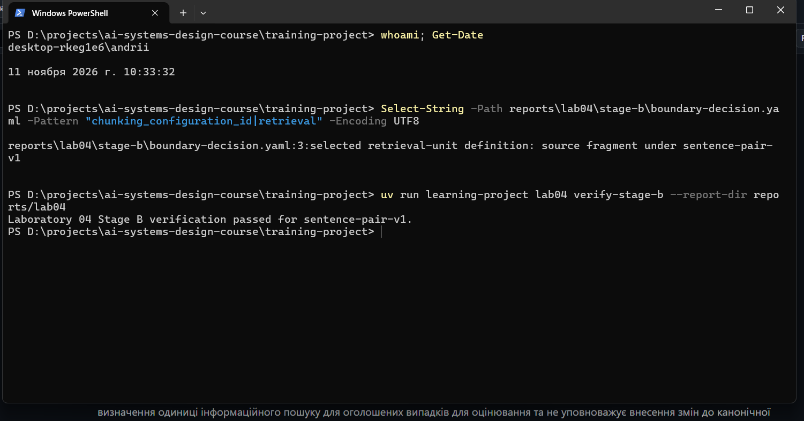
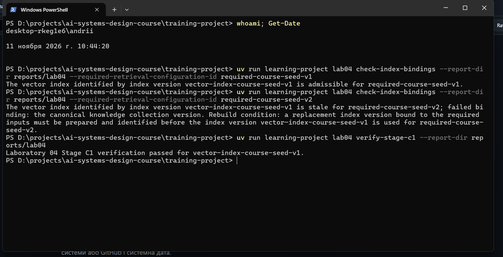
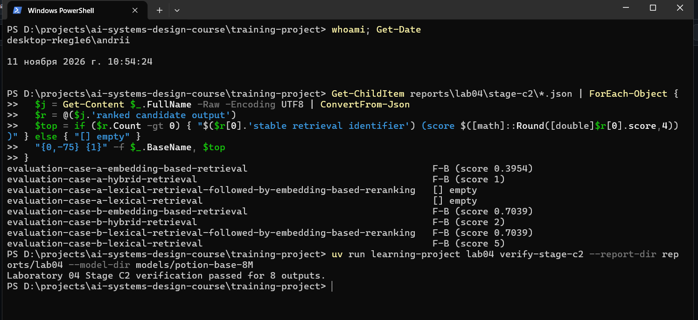
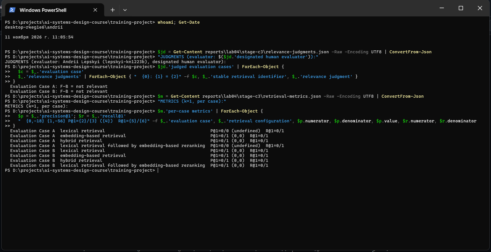
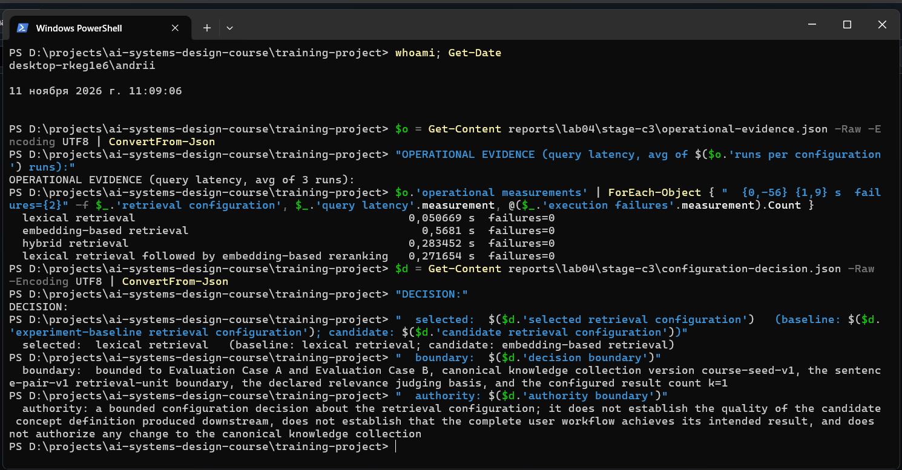

# Лабораторна робота 04

## Ідентифікація

- Прізвище та ім’я студента: Лепський Андрій (Andrii Lepskyi), група KN-1223b
- Ідентифікатор студента: lepskyi-kn1223b
- URL форка: https://github.com/Andreww-uni/ai-systems-design-course
- Особиста гілка: lab04/lepskyi-kn1223b
- Статус завершення: `complete`

Повний хеш остаточного коміту та результат перевірки містяться в окремому згенерованому `verification-report.json`. Їх не вписують у цей звіт до коміту, оскільки така зміна створила б інший коміт.

## Мета роботи

Метою роботи є отримання свідчень, достатніх для того, щоб команда інженерів вирішила, чи має кандидатна конфігурація інформаційного пошуку — пошук на основі ембедингів (`embedding-based retrieval`) — замінити базову конфігурацію експерименту — лексичний пошук (`lexical retrieval`) — для оцінюваного використання операції інформаційного пошуку над канонічною колекцією знань `course-seed-v1`. Рішення має спиратися на обґрунтовану межу одиниці інформаційного пошуку, версійований векторний індекс із перевіреними прив’язками, судження про релевантність, метрики `precision@1` і `recall@1` з явними чисельниками та знаменниками й окремі операційні свідчення.

## Хід виконання

### Вибір межі одиниці інформаційного пошуку

Гілку `lab04/lepskyi-kn1223b` створено від завершеної гілки `lab03/lepskyi-kn1223b`, виконано `uv sync --extra lab04` і скопійовано шаблон звіту. Команда `lab04 prepare-boundaries` застосувала до наданих канонічних записів знань `R-A` і `R-B` (версія колекції `course-seed-v1`, обидва записи з `student_generated: false` і `student_approved: false`) дві конфігурації розбивки на фрагменти. Конфігурація `sentence-pair-v1` (щонайбільше два речення без перекриття) створила одиниці `F-A` і `F-B`; конфігурація `fixed-72-v1` (щонайбільше 72 символи без перекриття) створила `F-A-72-1`–`F-A-72-4` і `F-B-72-1`–`F-B-72-2`. Кожен фрагмент має стабільний ідентифікатор пошуку, зв’язок походження (наприклад, для `F-A`: запис `R-A` версії 1, джерело `course-source-a` версії 1, діапазон символів `1-215`) і класифікацію `derived retrieval-side artifact; not a canonical knowledge collection member`.

Огляд показав, що `F-A` («A provenance link binds each evidence passage to its originating record identifier, record version, and exact sentence span…») містить разом ідентифікатор первинного запису, версію запису й точне місце підтвердного уривка, яких вимагає підстава для судження про релевантність обох випадків для оцінювання. За `fixed-72-v1` ці елементи розірвано між `F-A-72-1`, `F-A-72-2` і наступними фрагментами, тому жоден окремий фрагмент не задовольняє підставу без реконструкції. Діючи як команда інженерів, межу `sentence-pair-v1` зафіксовано командою `record-boundary-decision`; рішення обирає `source fragment under sentence-pair-v1` як визначення одиниці інформаційного пошуку і не уповноважує змін канонічної колекції знань. Команда `verify-stage-b` завершилася успішно для `sentence-pair-v1`, що узгоджується з `boundary-comparison.json` і `boundary-decision.yaml` та дозволило перейти до підготовки ембедингів.

Рисунок — `01-boundary-selection.png`

### Ембединги та векторний індекс

Командою `fetch-embedding-model` один раз отримано оголошену локальну модель ембедингу `minishlab/potion-base-8M` ревізії `bf8b056651a2c21b8d2565580b8569da283cab23`; каталог моделі розташовано поза відстежуваними свідченнями. Команда `prepare-embeddings` створила по одному ембедингу для `F-A` і `F-B` з розмірністю 256, версією представлення `course-static-embed-v1` і простором ембедингів `potion-base-8M@bf8b056651a2c21b8d2565580b8569da283cab23/course-static-embed-v1`. Команда `prepare-index` записала маніфест індексу з версією індексу `vector-index-course-seed-v1`, версією колекції `course-seed-v1`, конфігурацією розбивки `sentence-pair-v1`, прив’язками моделі та представлення і метаданими прив’язки для двох проіндексованих одиниць `F-A` і `F-B`. Векторний індекс є похідним станом для пошуку, а не канонічним записом знань.

Дві перевірки прив’язок перед використанням класифікували той самий індекс без його перебудови: для `required-course-seed-v1` — як придатний (`admissible`), для `required-course-seed-v2` — як застарілий (`stale`) з невдалою прив’язкою «the canonical knowledge collection version» та умовою перебудови: до використання для `required-course-seed-v2` має бути підготовлено й ідентифіковано нову версію індексу, прив’язану до потрібних входів. Придатний результат для `course-seed-v1` дозволив виконувати інформаційний пошук над цією версією; застарілий індекс для `course-seed-v2` не використовувався. Команда `verify-stage-c1` завершилася успішно для `vector-index-course-seed-v1`, що узгоджується з `retrieval-unit-embeddings.json`, `index-manifest.json` і двома записами перевірки прив’язок.

Рисунок — `02-embedding-index.png`

### Порівняння конфігурацій інформаційного пошуку

Два випадки для оцінювання виконано за чотирма конфігураціями інформаційного пошуку з `k = 1`. Текстовий запит `Evaluation Case A` («How can an auditor trace an excerpt to its origin and revision?») належить до групи ризику лексичного промаху, а запит `Evaluation Case B` («Which source and version identify the supporting passage for a concept proposal?») — до групи ризику лексичного хибного спрацювання. Отримано вісім ранжованих кандидатних виходів:

| Випадок | lexical retrieval | embedding-based retrieval | hybrid retrieval | lexical retrieval followed by embedding-based reranking |
|---|---|---|---|---|
| Evaluation Case A | порожній вихід | `F-B`, бал 0.3954 | `F-B`, бал 1.0 | порожній вихід |
| Evaluation Case B | `F-B`, бал 5 | `F-B`, бал 0.7039 | `F-B`, бал 2.0 | `F-B`, бал 0.7039 |

Порожній вихід лексичного пошуку для `Evaluation Case A` означає відсутність спільних змістових слів між запитом і одиницями, а не відмову виконання; конфігурація з переранжуванням отримала порожній обмежений набір кандидатів і тому також повернула порожній вихід. Жодна команда не завершилася помилкою. Команда `verify-stage-c2` завершилася успішно для восьми виходів, що узгоджується з вісьмома JSON-файлами в `stage-c2/`. Ранжовані виходи є свідченнями ранжування для двох оголошених випадків і не свідчать про загальну перевагу будь-якого механізму пошуку; успішна перевірка всіх восьми виходів дозволила перейти до суджень про релевантність.

Рисунок — `03-retrieval-comparison.png`

### Судження про релевантність і метрики

Діючи як призначений оцінювач-людина, оголошену підставу для судження («A retrieval unit must explain which data identify the originating record, the originating record version, and the exact location of the supporting passage.») застосовано до кожної поверненої одиниці. В обох випадках повернуто лише `F-B` («A proposal-run receipt records the source and version of the model used to produce a concept proposal; it does not locate the evidence passage.»), і обидва судження — `not relevant`: фрагмент описує джерело й версію моделі, а не первинний запис, і прямо зазначає, що не визначає місця підтвердного уривка; у `Evaluation Case B` спільні слова «source» і «version» стосуються моделі, а не уривка. Очікуваний результат лише для оцінювача (`F-A` для обох випадків) операції інформаційного пошуку не передавався.

Команда `compute-retrieval-metrics` обчислила метрики з явними чисельниками та знаменниками:

| Випадок | Конфігурація | `precision@1` | `recall@1` |
|---|---|---|---|
| A | lexical retrieval | 0 / 0 — `undefined` | 0 / 1 |
| A | embedding-based retrieval | 0 / 1 = 0.00 | 0 / 1 |
| A | hybrid retrieval | 0 / 1 = 0.00 | 0 / 1 |
| A | lexical retrieval followed by embedding-based reranking | 0 / 0 — `undefined` | 0 / 1 |
| B | lexical retrieval | 0 / 1 = 0.00 | 0 / 1 |
| B | embedding-based retrieval | 0 / 1 = 0.00 | 0 / 1 |
| B | hybrid retrieval | 0 / 1 = 0.00 | 0 / 1 |
| B | lexical retrieval followed by embedding-based reranking | 0 / 1 = 0.00 | 0 / 1 |

`precision@1` для порожнього виходу є невизначеним, а не нулем, оскільки немає жодної поверненої одиниці для судження; `recall@1` залишається визначеним (0 / 1), бо розглянута релевантна одиниця `F-A` існує в очікуваному результаті. Агреговані метрики: lexical retrieval — `precision@1` 0 / 1, `recall@1` 0 / 2; embedding-based retrieval — 0 / 2 і 0 / 2; hybrid retrieval — 0 / 2 і 0 / 2; lexical retrieval followed by embedding-based reranking — 0 / 1 і 0 / 2. Опис узгоджується з `relevance-judgments.json` і `retrieval-metrics.json`; повне покриття повернених одиниць судженнями та перевірена арифметика дозволили перейти до операційних вимірювань і рішення.

Рисунок — `04-relevance-metrics.png`

### Операційні свідчення та обмежене рішення

Команда `measure-operational-evidence` з трьома запусками в одному процесі зафіксувала операційні свідчення з власними межами вимірювання. Вартість побудови або оновлення індексу повторно не вимірювалася: використано одну зафіксовану підготовку індексу. Затримка запиту (секунди фактично минулого часу на одноразове виконання обох запитів, середнє за 3 запусками): lexical retrieval — 0.0507 с, embedding-based retrieval — 0.5681 с, hybrid retrieval — 0.2835 с, lexical retrieval followed by embedding-based reranking — 0.2717 с. Вартість запиту визначено як операції кодування за оголошеного кодувальника; лексичне оцінювання на центральному процесорі не додає вартості моделі. Споживання ресурсів — повторне використання локальної моделі в одному процесі без доступу до мережі. Помилок виконання не зафіксовано для жодної конфігурації. Ці вимірювання не входять до чисельників або знаменників метрик релевантності.

Діючи як команда інженерів, зафіксовано рішення з обраною конфігурацією `lexical retrieval`. Обґрунтування: за жодної конфігурації не повернуто розглянуту релевантну одиницю `F-A` (агрегований `recall@1` — 0 / 2 для всіх); кандидатна конфігурація на основі ембедингів повернула нерелевантну `F-B` там, де базова лексична конфігурація не повернула жодної одиниці, і виявилася повільнішою; отже, свідчення не обґрунтовують заміну базової конфігурації кандидатною. Межа рішення: `Evaluation Case A` і `Evaluation Case B`, версія колекції `course-seed-v1`, межа одиниці `sentence-pair-v1`, оголошена підстава для судження про релевантність і `k = 1`. Межа повноважень: рішення не встановлює якості кандидатного визначення поняття на подальшому етапі, не встановлює досягнення задуманого результату повним робочим процесом користувача і не уповноважує змін канонічної колекції знань. Опис узгоджується з `operational-evidence.json` і `configuration-decision.json`.

Рисунок — `05-operational-decision.png`

### Остаточна перевірка

Команда `verify-stage-c3` завершилася успішно для восьми записів метрик: верифікатор незалежно переобчислив арифметику метрик із зафіксованих суджень і перевірених восьми ранжованих виходів, не фіксуючи власних суджень. Після заповнення звіту виконано публічні тести, `lab04 validate-report`, коміт свідчень у `reports/lab04/`, надсилання гілки до форка та остаточну перевірку `lab04 verify` для точного HEAD гілки. Результат перевірки та повний хеш остаточного коміту записано в згенерованому `verification-report.json`, а не в цьому закоміченому звіті. Успішна перевірка доменних артефактів, структури звіту, шести посилань на знімки та незмінності закомічених свідчень дозволяє сформувати матеріали для подання; після перевірки закомічені свідчення не редагувалися. Як допоміжний інструмент для пояснень і підготовки команд використано Claude; судження про релевантність і рішення щодо конфігурації зафіксовано від імені студента.

Рисунок — `06-final-verification.png`

## Висновки

Обрано конфігурацію розбивки `sentence-pair-v1`, оскільки лише вона зберігає в одній одиниці ідентифікатор первинного запису, його версію та точне місце підтвердного уривка. Підготовлено версійований векторний індекс `vector-index-course-seed-v1`, придатний для `course-seed-v1` і застарілий для `course-seed-v2`. Отримано вісім ранжованих кандидатних виходів, у яких жодна з чотирьох конфігурацій не повернула релевантної одиниці `F-A`: агрегований `recall@1` дорівнює 0 / 2 для всіх конфігурацій, а `precision@1` — 0 / 1 для лексичного пошуку та пошуку з переранжуванням (з невизначеним значенням для порожнього виходу `Evaluation Case A`) і 0 / 2 для пошуку на основі ембедингів і гібридного пошуку. Операційні свідчення показали найменшу затримку для лексичного пошуку без помилок виконання. Обмежене рішення зберігає базову конфігурацію `lexical retrieval` лише для двох оголошених випадків за `k = 1`. На підставі наведених свідчень мету роботи досягнуто повністю: пакет свідчень дає змогу ухвалити обмежене рішення щодо конфігурації, хоча саме рішення засвідчує, що жодна порівняна конфігурація не розв’язує оголошені випадки.
