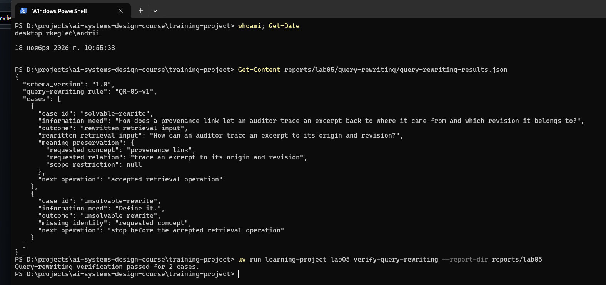
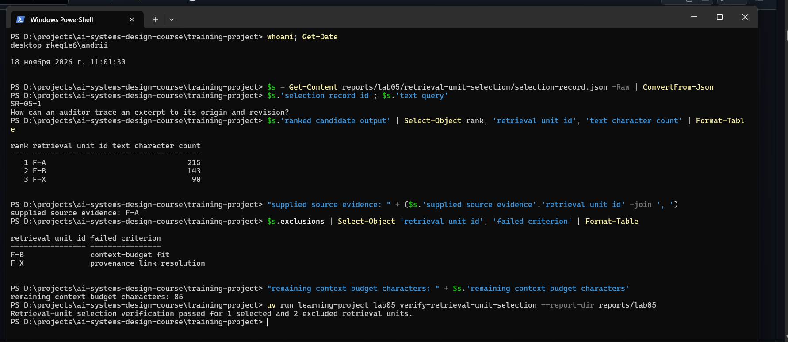
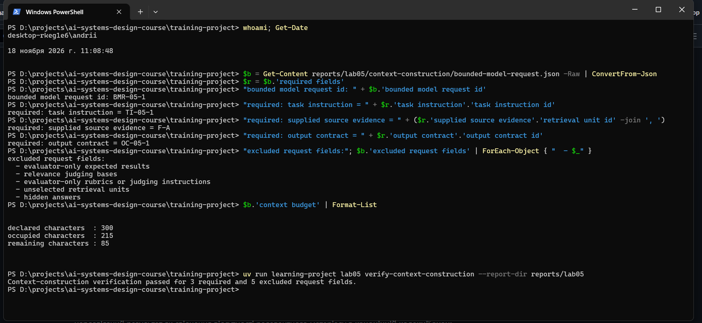
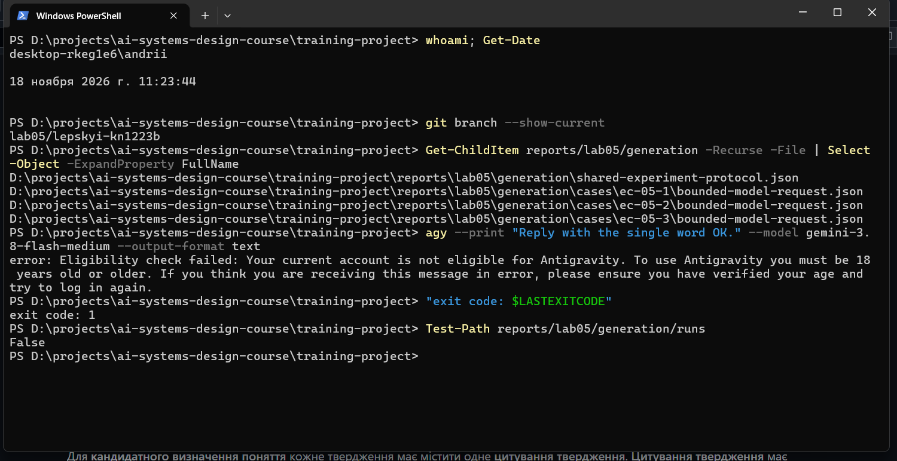
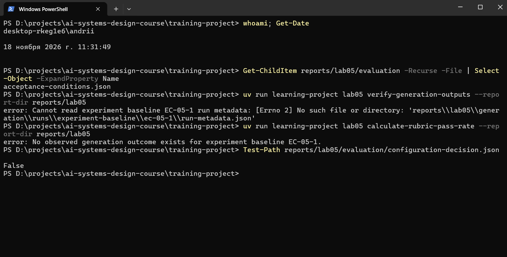

# Лабораторна робота 05

## Ідентифікація

- Прізвище та ім’я студента: Лепський Андрій (Andrii Lepskyi), група KN-1223b
- Ідентифікатор студента: lepskyi-kn1223b
- URL форка: https://github.com/Andreww-uni/ai-systems-design-course
- Особиста гілка: lab05/lepskyi-kn1223b
- Статус завершення: `honest-partial`

Повний хеш остаточного коміту та результат перевірки містяться в окремому згенерованому `verification-report.json`. Їх не вписують у цей звіт до коміту, оскільки така зміна створила б інший коміт.

## Мета роботи

Метою роботи є закриття двох прогалин шляху RAG, залишених модулем 04: перетворення інформаційної потреби на вхід інформаційного пошуку та перетворення ранжованого кандидатного виходу на надані джерельні свідчення для генерування. На цьому шляху має бути виконано генерування, результатом якого є кандидатне визначення поняття або відмова, а згенеровані результати мають бути оцінені за рубрикою оцінювання для ухвалення обмеженого рішення щодо конфігурації.

## Хід виконання

### Переписування запиту

Дія. До двох наданих інформаційних потреб застосовано правило переписування запиту `QR-05-v1` командою `lab05 apply-query-rewriting`, після чого виконано перевірку `lab05 verify-query-rewriting`.

Спостережений результат. Для випадку `solvable-rewrite` отримано переписаний вхід інформаційного пошуку `How can an auditor trace an excerpt to its origin and revision?`. Запитане поняття `provenance link` і запитане відношення `trace an excerpt to its origin and revision` збережено, обмеження області відсутнє (`null`), наступною операцією названо прийняту операцію інформаційного пошуку. Для випадку `unsolvable-rewrite` (`Define it.`) зафіксовано нерозв’язне переписування: відсутньою ідентичністю є `requested concept`, переписаний вхід відсутній, наступна операція — `stop before the accepted retrieval operation`. Жоден результат не містить ранжованого кандидатного виходу. Перевірка повідомила `Query-rewriting verification passed for 2 cases.`

Підстава для продовження. Розв’язний випадок зберігає запитане поняття, відношення та область, тому його вхід може передаватися до відбору одиниць інформаційного пошуку. Нерозв’язний випадок не називає поняття, а правило забороняє вигадувати відсутню ідентичність, тому будь-який пошук відповідав би на інше питання, ніж поставлене. Зупинка не дає підстави робити висновок про відсутність релевантного матеріалу в канонічній колекції знань, оскільки пошук не виконувався.

Узгодженість машинних свідчень. Опис і знімок відповідають файлу `query-rewriting/query-rewriting-results.json` і повідомленню перевірки.

Рисунок — `01-query-rewriting.png`

### Відбір одиниць інформаційного пошуку

Дія. До ранжованого кандидатного виходу з трьох одиниць застосовано критерії допуску `RUS-05-v1` у заданому порядку (розв’язання посилання на походження, потім відповідність бюджету контексту) командою `lab05 apply-retrieval-unit-selection`, після чого виконано перевірку `lab05 verify-retrieval-unit-selection`.

Спостережений результат. Запис відбору `SR-05-1` прив’язано до переписаного входу інформаційного пошуку. Ранжований кандидатний вихід містить `F-A` (215 символів), `F-B` (143) і `F-X` (90). До наданих джерельних свідчень допущено лише `F-A`. `F-B` не допущено з підставою `context-budget fit`: після `F-A` залишилося 85 символів, що менше за 143. `F-X` не допущено з підставою `provenance-link resolution`, а відповідність бюджету для нього не оцінювалася. Залишок бюджету контексту — 85 символів із 300. Перевірка повідомила `Retrieval-unit selection verification passed for 1 selected and 2 excluded retrieval units.`

Підстава для продовження. Ранг і бал подібності описують лише порядок, у якому операція інформаційного пошуку повернула кандидатів, і не засвідчують ні простежуваності джерела, ні вміщення в бюджет. Допуск визначається лише оголошеними критеріями, тому присутність `F-X` у ранжованому виході не є допуском, а недопуск `F-B` не є доведенням його нерелевантності. `F-X` виключено без перевірки бюджету, оскільки одиниця без розв’язаного посилання на походження не може бути надана як джерельне свідчення незалежно від її довжини.

Узгодженість машинних свідчень. Опис і знімок відповідають файлу `retrieval-unit-selection/selection-record.json` і повідомленню перевірки.

Рисунок — `02-retrieval-unit-selection.png`

### Побудова обмеженого запиту до моделі

Дія. Над допущеними джерельними свідченнями `{F-A}` побудовано обмежений запит до моделі командою `lab05 apply-context-construction`, після чого виконано перевірку `lab05 verify-context-construction`.

Спостережений результат. Обмежений запит `BMR-05-1` містить рівно три обов’язкові поля: інструкцію завдання `TI-05-1`, надані джерельні свідчення лише з `F-A` разом із його посиланням на походження та контракт виходу `OC-05-1`. Поза запитом залишено п’ять виключених полів: очікувані результати лише для оцінювача, підстави суджень про релевантність, рубрики або інструкції лише для оцінювача, невідібрані одиниці інформаційного пошуку та приховані відповіді. Бюджет контексту: оголошено 300 символів, зайнято 215, залишок 85. Наступна операція — операція пропозиції поняття з використанням моделі. Перевірка повідомила `Context-construction verification passed for 3 required and 5 excluded request fields.`

Підстава для продовження. Виключене поле запиту не має входити в обмежений запит, оскільки матеріал оцінювача або прихована відповідь дали б моделі доступ до очікуваного результату, і подальше оцінювання перевіряло б відтворення відповіді, а не генерування з наданих свідчень. Невідібрана одиниця повернула б до запиту текст, який не пройшов критерії допуску, і зруйнувала б межу між ранжованим виходом і наданими свідченнями.

Узгодженість машинних свідчень. Опис і знімок відповідають файлу `context-construction/bounded-model-request.json` і повідомленню перевірки.

Рисунок — `03-context-construction.png`

### Генерування з цитуванням твердження або відмова

Дія. Командою `agy models` підтверджено наявність ідентифікатора моделі `gemini-3.8-flash-medium` у каталозі AGY (Antigravity CLI 1.5.11). Командою `lab05 prepare-generation-cases` створено спільний протокол експерименту `SEP-05-1` і три заморожені випадки оцінювання. Обидві конфігураційні ролі використовують адаптер `agy` і модель `gemini-3.8-flash-medium`: базова конфігурація експерименту має профіль інструкції `request-only`, кандидатна конфігурація — `evidence-guarded`. Після цього виконано перший запуск `lab05 run-generation-agy` для ролі базової конфігурації експерименту та випадку `EC-05-1`.

Спостережений результат. Перший запуск завершився повідомленням `AGY generation failed without writing run evidence.` Для встановлення причини виконано окремий діагностичний виклик `agy --print` поза робочим процесом лабораторної роботи. AGY повернув помилку `Eligibility check failed`: обліковий запис Google не пройшов перевірку відповідності вимогам Antigravity (підтвердження віку), код завершення 1, використано 0 токенів. Отже, каталог моделей доступний, а виконання запитів до моделі заблоковане на боці постачальника. Каталог `generation/runs/` не створено, жодного кандидатного визначення поняття чи відмови не спостережено. Решту п’яти запусків не виконувалося, оскільки кожен із них звертається до того самого заблокованого облікового запису, а повторний запуск тієї самої пари «роль — випадок» не допускається.

Підстава для зупинки. Генерування зупинено на межі доступності зовнішнього постачальника. Спільний протокол, модель і випадки оцінювання не змінювалися, заміна адаптера або моделі не виконувалася, а результати генерування не створювалися вручну. Тому твердження про цитування твердження та про відмову через непряму ін’єкцію промпту залишаються неперевіреними на спостережених виходах. Принципово цитування твердження лише робить пару «твердження — одиниця інформаційного пошуку» доступною для перевірки, але не встановлює, що одиниця підкріплює твердження: це судження належить оцінювачу-людині. Непряма ін’єкція промпту має породжувати відмову, оскільки контракт виходу `OC-05-1` допускає лише кандидатне визначення поняття або відмову, а конфліктна інструкція в одиниці `F-I` від недовіреного автора джерела є умовою, що блокує виконання `TI-05-1`.

Узгодженість машинних свідчень. Знімок показує чотири створені файли (`shared-experiment-protocol.json` і три `bounded-model-request.json` у `generation/cases/`), помилку AGY з кодом завершення 1 і відсутність каталогу `generation/runs/`, що відповідає вмісту каталогу `generation/`.

Рисунок — `04-generation-outcomes.png`

### Оцінювання та обмежене рішення щодо конфігурації

Дія. Командою `lab05 prepare-acceptance-conditions` заморожено умови прийняття, прив’язані до `SEP-05-1`. Після цього виконано `lab05 verify-generation-outputs` і `lab05 calculate-rubric-pass-rate` та перевірено наявність запису рішення щодо конфігурації.

Спостережений результат. Файл `evaluation/acceptance-conditions.json` створено: мінімальна частка проходження рубрики оцінювання 1.00, максимальна затримка 330.0 с на згенерований вихід, максимальні витрати на перегляд людиною 5 хв на вихід, випадок конфліктної інструкції `EC-05-3`, свідчення про використання токенів недоступні з адаптера AGY. Перевірка генерування завершилася помилкою через відсутність `generation/runs/experiment-baseline/ec-05-1/run-metadata.json`, а обчислення частки проходження рубрики — помилкою `No observed generation outcome exists for experiment baseline EC-05-1.` Суджень за рубрикою оцінювання не записано, частки проходження рубрики оцінювання не обчислено, умови прийняття не оцінено, файл `configuration-decision.json` відсутній. Обмежене рішення щодо конфігурації не ухвалено.

Підстава для зупинки. Судження оцінювача-людини можна записати лише щодо спостереженого виходу, тому за відсутності шести виходів оцінювання не має об’єкта. Частки проходження рубрики оцінювання за правилами обчислюють окремо для кожної конфігураційної ролі, оскільки рішення порівнює дві повні конфігурації, і об’єднаний показник приховав би провал однієї з них за успіхом іншої. Навіть ухвалене рішення стосувалося б лише заміни базової конфігурації експерименту кандидатною на трьох випадках розробки і не уповноважувало б зміну канонічної колекції знань, вибір конфігурації інформаційного пошуку чи висновки щодо відкладених даних.

Узгодженість машинних свідчень. Знімок показує єдиний файл `acceptance-conditions.json` у каталозі `evaluation/`, дві помилки команд оцінювання і відсутність `configuration-decision.json`, що відповідає вмісту каталогу `evaluation/`.

Рисунок — `05-configuration-decision.png`

### Остаточна перевірка

Дія. Звіт заповнено, виконано перевірку `lab05 validate-report`, весь каталог `reports/lab05` закомічено в особисту гілку та виконано остаточну перевірку `lab05 verify` для точного HEAD гілки.

Спостережений результат. Перевірка звіту підтвердила заголовки, ідентифікацію, статус завершення, відсутність data URI та посилання на знімки, але завершилася помилкою перевірки `stage-evidence`, оскільки відсутні вісімнадцять файлів у `generation/runs/` та записи суджень, часток проходження рубрики оцінювання, оцінювання умов прийняття й рішення щодо конфігурації. Остаточна перевірка записала у `verification-report.json` результат для повного хеша остаточного коміту; невдалою в ньому є лише перевірка наявності свідчень, що відповідає статусу `honest-partial`.

Підстава для завершення. Подання виконується за шляхом зупинки, передбаченим лабораторною роботою для статусу `honest-partial`: наявні свідчення закомічено без змін, невдалу перевірку зафіксовано, а відсутні результати не відтворювалися штучно.

Узгодженість машинних свідчень. Знімок показує той самий результат і той самий остаточний коміт, які записані у `verification-report.json`. Після остаточної перевірки закомічені свідчення не редагувалися.

Рисунок — `06-final-verification.png`

## Висновки

Виконано переписування запиту (один розв’язний вхід і одна обґрунтована зупинка), відбір одиниць інформаційного пошуку (допущено `F-A`, `F-B` і `F-X` виключено з різних підстав, залишок бюджету 85 символів) і побудову обмеженого запиту до моделі `BMR-05-1` з трьома обов’язковими і п’ятьма виключеними полями. Усі три перевірки пройдено. Також створено спільний протокол експерименту `SEP-05-1`, три випадки оцінювання та заморожені умови прийняття.

Мету роботи досягнуто частково. Відсутні шість спостережених виходів операції пропозиції поняття з використанням моделі, судження за рубрикою оцінювання, частки проходження рубрики оцінювання, оцінювання умов прийняття та обмежене рішення щодо конфігурації. Причина — блокування генерування на боці постачальника: AGY відхиляє запити до моделі з помилкою `Eligibility check failed`, оскільки обліковий запис Google не пройшов перевірку відповідності вимогам Antigravity. Тому питання про те, чи має кандидатна конфігурація замінити базову, залишається відкритим.
